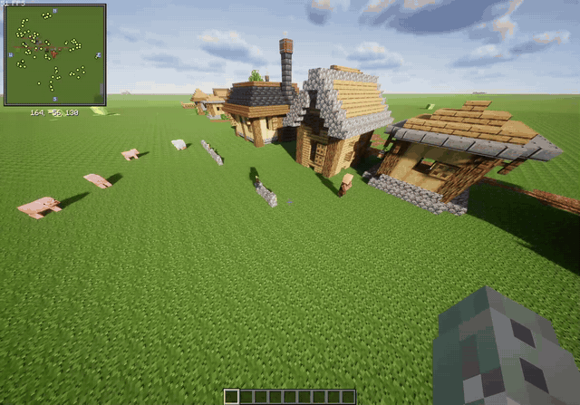

<p align="center">
  <strong>Regrowth for modern Fabric, with village behavior that adapts to modded layouts.</strong>
</p>

> **Regrowth: Revamped is an unofficial continuation.** It is based on [Regrowth](https://github.com/mactso/Regrowth) by MacTso and Lupicus and is not an official upstream release.

Regrowth gives creatures small environmental effects and lets villagers maintain their settlements over time. Animals can eat or spread vegetation, monsters retain their original environmental actions, and villagers repair farms, roads, lighting, vegetation, and village walls.

Revamped ports the mod to Minecraft 26.2 and replaces the original assumption of a small square village with a safer, data-driven planning system intended for custom village structures and large modpacks.

## Features

- Minecraft 26.2 support on Fabric
- server-side operation; clients do not need the mod
- works in dedicated servers and singleplayer integrated servers
- adaptive boundaries built from meeting, home, and job-site POIs
- gates and openings where roads cross the planned wall
- terrain-aware, incremental wall construction
- original fixed-square wall algorithm available as `legacy` mode
- conservative block replacement with protected-block and foundation tags
- data-pack profiles for biome, structure, material, and road behavior
- data-pack profession roles for vanilla and modded villagers
- cached plans instead of recalculating village geometry every villager tick
- per-village analysis, preview, enable/disable, mode, and rebuild controls

## Adaptive village walls

The default `poi_hull` mode expands a boundary around nearby village POIs and scans that boundary for roads. Villagers then build it gradually, one local block at a time.

Wall construction keeps Regrowth's original control-block behavior. Unless `key.playerWallControlBlockString` is set to `minecraft:air`, the configured control block must be directly above the village meeting POI. New village chunks receive this block automatically.

Use `legacy` mode if you prefer the original fixed-square perimeter.



## Villager actions

The default villager action string remains `chrwvt`.

| Letter | Action |
| --- | --- |
| `c` | Clear obstructing natural vegetation |
| `h` | Let clerics heal people and toolsmiths repair iron golems |
| `r` | Clear snow and repair likely road gaps |
| `w` | Build planned village walls and road-crossing gates |
| `v` | Trim natural leaves and cactus |
| `t` | Place lighting in dark areas, near farms, and along walls |

Farm maintenance and profession-specific flower planting are assigned through profession roles and do not use these letters.

## Commands

Commands require game-master permission and select the nearest meeting POI within 96 blocks.

| Command | Description |
| --- | --- |
| `/regrowth village analyze` | Show the selected profile, mode, control state, and plan size |
| `/regrowth village preview` | Display the planned boundary with particles |
| `/regrowth village preview walls` | Alias for the boundary preview |
| `/regrowth village enable` | Resume road and wall work |
| `/regrowth village disable` | Pause road and wall work |
| `/regrowth village mode default` | Use the profile's configured mode |
| `/regrowth village mode adaptive` | Use the POI-derived boundary |
| `/regrowth village mode legacy` | Use the fixed-square boundary |
| `/regrowth village rebuild` | Discard and recalculate the cached plan |

## Requirements

- Minecraft 26.2
- Java 25
- Fabric Loader 0.19.3 or newer
- [Fabric API](https://modrinth.com/mod/fabric-api) 0.158.0+26.2 or a compatible release

Fabric API must also be listed as a required dependency on each version.

## Installation

1. Install Fabric Loader and Fabric API.
2. Place the Regrowth: Revamped JAR in the server's `mods` directory.
3. Start the server once to generate `config/regrowthconfig.properties`.

For singleplayer, place the JAR in the instance's `mods` directory. The mod runs through the integrated server.

> Villagers can change roads and construct walls. Back up an existing world, or test on a copy, before adding the mod to a long-running save.

## Data-pack integration

Village profiles:

```text
data/<namespace>/regrowth/village_profiles/*.json
```

Profession roles:

```text
data/<namespace>/regrowth/profession_roles/*.json
```

Available safety and material tags:

- `regrowth:wall_foundations`
- `regrowth:wall_replaceable`
- `regrowth:road_replaceable`
- `regrowth:village_roads`
- `regrowth:protected_from_villagers`

Block entities are always protected. Other mods can append blocks to these tags without adding a Java dependency.

The complete profile format is documented in the [adaptive villages guide](https://github.com/cairodavila/regrowth-revamped/blob/main/docs/adaptive-villages.md).

## Source and issues

- [Source code](https://github.com/cairodavila/regrowth-revamped)
- [Issue tracker](https://github.com/cairodavila/regrowth-revamped/issues)

Please report Revamped-specific issues here rather than on the original project's tracker.

## Credits

- MacTso and Lupicus — original Regrowth design and implementation
- Cairo D'Avila — current Fabric ports and adaptive village work

Original project:

- [GitHub](https://github.com/mactso/Regrowth)
- [CurseForge](https://www.curseforge.com/minecraft/mc-mods/regrowth)

## License

Regrowth: Revamped is distributed under the [MIT License](https://github.com/cairodavila/regrowth-revamped/blob/main/LICENSE). The original copyright and permission notice are preserved in the source repository and packaged JAR.

## AI disclosure

AI-assisted coding and editing tools were used during the port, adaptive-village implementation, testing, and preparation of this project page. The gameplay GIF above is an in-game screen recording.
