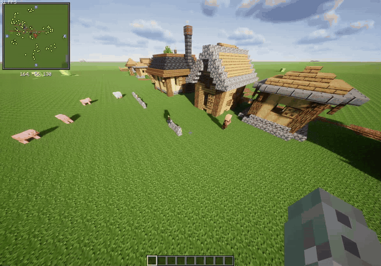

<p align="center">
  
</p>

# Regrowth: Revamped

[](https://modrinth.com/mod/regrowth-revamped)
[](https://www.minecraft.net/)
[](https://fabricmc.net/)
[](LICENSE)

an unofficial Fabric continuation of [Regrowth](https://github.com/mactso/Regrowth) by MacTso and Lupicus.

Regrowth lets creatures affect nearby vegetation and gives villagers small jobs around their villages. Revamped ports the mod to current Minecraft versions and adds adaptive village planning for modded and overhauled villages.

[changelog](CHANGELOG.md) · [adaptive villages guide](docs/adaptive-villages.md)

## what changed

- Minecraft 26.2 and 26.3 support on Java 25
- village boundaries generated from nearby meeting, home and job-site POIs
- one wall ring per village, however many bells it has
- road-crossing gates instead of walls placed across paths
- walls that grow as connected runs and step with the terrain, with the original square layout available as `legacy` mode
- lamp posts beside dark village paths, in the style of vanilla's village lamps
- conservative block replacement using data-pack tags
- data-driven biome and structure profiles
- data-driven profession roles for vanilla and modded villagers
- per-village analyze, preview, enable, disable, mode and rebuild commands
- cached village plans instead of recalculating geometry on every villager tick

the existing animal and monster actions still work the same way.

## requirements

| Minecraft | Fabric API | Fabric Loader | Java |
| --- | --- | --- | --- |
| 26.3 | 0.165.2+26.3 or newer | 0.19.3 or newer | 25 |
| 26.2 | 0.161.0+26.2 or newer | 0.19.3 or newer | 25 |

## installation

1. download the JAR for your Minecraft version from [Modrinth](https://modrinth.com/mod/regrowth-revamped). the file name ends in the Minecraft version, like `1.2.0+26.3`.
2. copy it into the instance's `mods` directory.
3. start Minecraft once to create `config/regrowthconfig.properties`.

villagers can change roads, build walls and put up lamp posts. back up an existing world, or try the mod on a copy first.

## adaptive villages

the default `poi_hull` mode builds a boundary around nearby village POIs and scans that boundary for roads. plans are cached by dimension and village. bells within 64 blocks of each other belong to one village, which gets one boundary centred on the bell nearest the middle of its homes and job sites; `/regrowth village analyze` reports that bell. villagers still work one block at a time; calculating a plan does not rebuild a village immediately.

the wall grows as connected runs: a villager near the boundary extends a stretch that's already started before beginning a new one. it steps up with the terrain, replaces grass, flowers and bushes in its way, and opens only where a road crosses it, with a fence gate in the middle of each opening. water is left open. a ring takes several in-game days, and a stretch no villager walks past stays open.

wall construction keeps Regrowth's original control-block behavior. unless `key.playerWallControlBlockString` is set to `minecraft:air`, the configured block must be directly above the village's bell, the one `analyze` reports; a block above any other bell of the same village doesn't count. new village chunks receive the control block automatically. a village that had already been explored before the mod was added gets no automatic block, so its walls don't start until someone places the configured control block on the bell that `analyze` reports.

use `legacy` mode if you prefer the original fixed-square wall layout.



### lamp posts

villagers with the lighting role put up lamp posts beside village paths where it's dark, a whole post at a time. a post stands on natural ground next to a road, never on it, and keeps clear of doors, beds, job sites and the wall line. the light itself spaces them out, usually 11 to 13 blocks apart.

| village | post |
| --- | --- |
| plains | two oak fences, stripped oak wood and four torches |
| desert | cut sandstone, terracotta and a torch |
| snowy | a spruce fence post with an arm and a hanging lantern |
| others | two fences of the village's wood and a torch |

posts go up in every village with villagers, including ones that were there before the update. to turn them off, set `lighting.lamp_post` to `none` in a village profile, or remove `t` from the villager entry in `key.actionMobList`, which also stops the other torches. `/regrowth village disable` pauses them for one village, together with road and wall work.

the full profile and role formats are in [docs/adaptive-villages.md](docs/adaptive-villages.md).

## villager actions

the default villager action string is still `chrwvt`:

| letter | action |
| --- | --- |
| `c` | clear obstructing grass (flowers are left alone) |
| `h` | let clerics heal people and toolsmiths repair iron golems |
| `r` | clear snow and repair likely gaps in roads |
| `w` | build village walls and road-crossing gates |
| `v` | trim natural leaves and cactus |
| `t` | put up lamp posts beside dark village paths, and place torches in dark covered spots, near farms and along walls |

farm maintenance and profession-specific flower planting are assigned through profession roles and don't use those letters.

## commands

commands need game-master permission and use the nearest meeting POI within 96 blocks.

| command | what it does |
| --- | --- |
| `/regrowth village analyze` | show the selected profile, mode, control state and plan size |
| `/regrowth village preview` | display the planned boundary with particles |
| `/regrowth village preview walls` | alias for the boundary preview |
| `/regrowth village enable` | resume road, wall and lamp post work |
| `/regrowth village disable` | pause road, wall and lamp post work |
| `/regrowth village mode default` | use the profile's configured mode |
| `/regrowth village mode adaptive` | use the POI-derived boundary |
| `/regrowth village mode legacy` | use the fixed-square boundary |
| `/regrowth village rebuild` | discard and recalculate the cached plan |

## data-pack integration

village profiles:

```text
data/<namespace>/regrowth/village_profiles/*.json
```

profession roles:

```text
data/<namespace>/regrowth/profession_roles/*.json
```

safety and material tags:

- `regrowth:wall_foundations`
- `regrowth:wall_replaceable`
- `regrowth:road_replaceable`
- `regrowth:village_roads`
- `regrowth:protected_from_villagers`

block entities are always protected. other mods can append blocks to these tags without a Java dependency.

## building

requires a **Java 25** JDK. Gradle picks it up by itself when one is installed, even if another Java is the default. one source tree builds every supported Minecraft version through [Stonecutter](https://stonecutter.kikugie.dev/).

```bash
git clone https://github.com/cairodavila/regrowth-revamped.git
cd regrowth-revamped
./gradlew buildAndCollect
```

the JARs for every version land in `build/libs/<mod version>/`. `./gradlew :26.2:build` builds a single version into `versions/26.2/build/libs/`.

<details>
<summary>adding a Minecraft version</summary>

1. add the version to `versions(...)` in `settings.gradle.kts`.
2. add a matching section with `mod.mc_compat` and `deps.fabric_api` to `stonecutter.properties.toml`.
3. wrap code that differs between versions in Stonecutter comments, for example:

```java
//? if >=26.3 {
block.performBonemeal(level, level.getRandom(), pos, state, BonemealSource.MOB);
//?} else {
/*block.performBonemeal(level, level.getRandom(), pos, state);
*///?}
```

`src/` always holds the code for the active version in `stonecutter.gradle.kts` (26.3). switch it with the `Set active project to …` Gradle tasks, and switch back before committing.

</details>

## versioning

Revamped uses semantic versioning. every release is built once per Minecraft version, and the Minecraft version is added as build metadata: `1.2.0+26.2` and `1.2.0+26.3` are the same release. the [changelog](CHANGELOG.md) lists every release.

## credits

- MacTso and Lupicus — original Regrowth mod
- Cairo D'Avila — current Fabric ports and adaptive village work

original project:

- [GitHub](https://github.com/mactso/Regrowth)
- [CurseForge](https://www.curseforge.com/minecraft/mc-mods/regrowth)

please report fork-specific issues here rather than on the original project's issue tracker.

## license

Regrowth: Revamped is available under the [MIT license](LICENSE). the original copyright and license notice are preserved in the repository and packaged JAR.
